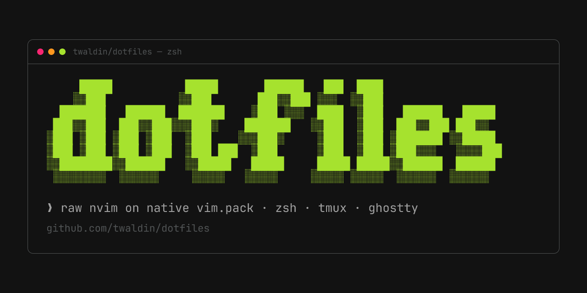

# dotfiles



my dotfiles: raw nvim on native vim.pack, zsh, tmux, Ghostty, native macOS window management, and SketchyBar.

## what's inside

| dir | what |
|-----|------|
| `nvim/` | raw neovim config in lua — plugins via native `vim.pack`, native `vim.lsp` |
| `zsh/` | zshrc + oh-my-posh prompt (`pure-modified.omp.json`) |
| `tmux/` | tmux.conf — `C-space` prefix, vi mode, tpm + resurrect + continuum |
| `terminal/ghostty/` | Ghostty config — Hardcore theme, JetBrains Nerd Font |
| `yabai/` + `skhd/` | recursive native-Space BSP, guarded activation, signed Accessibility wrappers |
| `aerospace/` | inactive, reversible window-manager fallback |
| `sketchybar/` | pinned SbarLua bar, static calendar status, supported status and control surfaces |
| `scripts/` | tmux-sessionizer, Ghostty base16 theme switcher, Claude statusline |
| `zen/` | zen browser userChrome.css + mods export |
| `agents/` | the old agent setup; each machine drops it when it moves to tstack (below) |
| `linux/` | CachyOS desktop: niri, Waybar, Fuzzel, keyd, Ghostty, and zsh |

## nvim

no distro, no lazyvim — plain lua loaded from `init.lua`.

- plugins managed by neovim's built-in `vim.pack` (nightly), pinned in `nvim-pack-lock.json`: base16-nvim, oil, fzf-lua, blink.cmp, mason, treesitter (main), gitsigns, mini.icons, nabla, typst-preview
- native `vim.lsp` — one config file per server under `nvim/lsp/`, servers installed via mason
- colorscheme is base16-nvim, auto-synced from ghostty — `theme.lua` reads `~/.config/ghostty/config`, maps the ghostty theme to its base16 scheme, then strips backgrounds for transparency
- completion: blink.cmp (super-tab); pickers: fzf-lua for files/grep/lsp/git; files: oil.nvim
- vendored lasso.nvim for harpoon-style file marks — `<leader>H` to mark, `<leader>1..9` to jump
- leader is space; keymaps in `nvim/lua/keybinds.lua`

## usage

no install script — symlink what you want into place:

```sh
ln -s "$PWD/nvim"                        ~/.config/nvim
ln -s "$PWD/zsh/zshrc"                   ~/.zshrc
ln -s "$PWD/zsh/zshenv"                  ~/.zshenv
ln -s "$PWD/zsh/pure-modified.omp.json"  ~/pure-modified.omp.json
ln -s "$PWD/tmux/.tmux.conf"             ~/.tmux.conf
ln -s "$PWD/terminal/ghostty/config"     ~/.config/ghostty/config
ln -s "$PWD/yabai"                       ~/.config/yabai
ln -s "$PWD/skhd"                        ~/.config/skhd
ln -s "$PWD/aerospace"                   ~/.config/aerospace
ln -s "$PWD/sketchybar"                  ~/.config/sketchybar
ln -s "$PWD/scripts"                     ~/scripts
mkdir -p "$HOME/Library/LaunchAgents"
ln -sfn "$PWD/yabai/launch-agents/com.asmvik.yabai.plist" "$HOME/Library/LaunchAgents/com.asmvik.yabai.plist"
ln -sfn "$PWD/yabai/launch-agents/com.koekeishiya.skhd.plist" "$HOME/Library/LaunchAgents/com.koekeishiya.skhd.plist"
```

tmux plugins need [tpm](https://github.com/tmux-plugins/tpm); nvim pulls its own plugins on first launch.

agents run on [tstack](https://github.com/twaldin/tstack) (the engine) plus my private instance. on a new box, once `gh`, Python 3.9+, omp and easl are installed and `gh auth login` and `omp login` are done:

```sh
gh repo clone twaldin/tstack ~/tstack
gh repo clone twaldin/agents ~/agents
~/tstack/bin/tstack setup --dry-run   # add --machine <name> if `hostname -s` isn't a dir in ~/agents/machines
~/tstack/bin/tstack setup             # add --timers on macOS for the hourly update and liveness jobs
~/tstack/bin/tstack check --smoke
```

after that, `tstack update` keeps `~/tstack`, `~/agents` and this repo current every hour on Linux, or on macOS if setup ran with `--timers`.

passwordless sudo for every command (same drop-in on every machine; `$USER` is `twaldin` on the Macs, `tim` on deckbox):

```sh
printf '%s ALL=(ALL:ALL) NOPASSWD: ALL\n' "$USER" > /tmp/sudoers.new && visudo -cf /tmp/sudoers.new &&
  sudo install -m 0440 -o root -g "$(id -gn root)" /tmp/sudoers.new "/etc/sudoers.d/90-$USER" && rm /tmp/sudoers.new && sudo -n true
```

The window-manager slice targets Apple-silicon macOS Tahoe. The checked-in launch agents use the macOS short name `twaldin`. For a different account, first replace every wrapper and log path in both plists with that account's absolute paths, then run `plutil -lint` on both files. The activation script rejects paths that do not match the current account or fixed platform prerequisites.

The window-manager lifecycle fails closed. On first Home adoption, stop the old yabai/skhd jobs, back up and remove prior launch-agent symlinks, and back up and remove the prior real `~/.config/{yabai,skhd,aerospace}` directories. Create native Spaces 1 through 9 on primary display 1 (external displays may have additional Spaces), publish only reviewed app bundles, run `/usr/bin/python3 -I yabai/deploy-lifecycle.py prepare --adopt-existing`, attest the exact Accessibility approvals, and then run its `activate` action. Use the same module's `rollback` action for guarded fallback. Never run both window managers together.

Install SketchyBar dependencies with `sketchybar/install-deps.sh`, run `sketchybar/scripts/smoke-config.sh`, and reload only after both pass. See `sketchybar/OPERATIONS.md` for permissions, runtime checks, and rollback.

terminal theme is Ghostty's `Hardcore` — nvim follows it automatically.

## CachyOS desktop

Install `niri`, `xwayland-satellite`, `waybar`, `fuzzel`, `keyd`, `swaybg`, `ghostty`, `zsh`, `neovim`, `jq`, `ttf-jetbrains-mono-nerd`, `wl-clipboard`, `fzf`, `fd`, and `ripgrep`. Install `oh-my-posh-bin` from the AUR for the shared prompt. The app hotkeys use `chromium`, `discord`, `steam`, `keepassxc`, and `slack-desktop` (AUR).

Back up your existing configs before copying these files from the repo root. If Fedora shares your home, do not replace a destination that Fedora uses. On this PC, the new desktop configs use paths the Fedora GNOME session did not use.

```sh
(
	set -e
	config="$HOME/.config"
	niri validate -c linux/niri/config.kdl
	install -Dm644 linux/waybar/config.jsonc "$config/waybar/config.jsonc"
	install -Dm644 linux/waybar/style.css "$config/waybar/style.css"
	install -Dm644 linux/fuzzel/fuzzel.ini "$config/fuzzel/fuzzel.ini"
	install -Dm644 linux/ghostty/config "$config/ghostty/config"
	install -Dm644 linux/zsh/.zshrc "$config/zsh/.zshrc"
	install -Dm644 zsh/pure-modified.omp.json "$config/zsh/pure-modified.omp.json"
	mkdir -p "$config/nvim-cachyos"
	cp -a nvim/. "$config/nvim-cachyos/"
	install -Dm755 linux/niri/send-floating "$config/niri/send-floating"
	install -Dm644 linux/niri/config.kdl "$config/niri/config.kdl"
)
```

Ghostty uses 50% live opacity without blur. It starts zsh with the Linux prompt and the `nvim-cachyos` profile. The existing `~/.zshrc` and default Neovim profile are unchanged.

Put the home Mac's `bg1-centered-3024x1964.png` in `~/Pictures/wallpapers/`. `swaybg` centers the PNG without zoom or stretch. Niri starts Waybar and `swaybg` at login. A live reload does not start them, so start missing processes once in the current niri session and reload an existing Waybar with `SIGUSR2`. The 179.998 Hz rule targets the Acer on `DP-2`.

For Caps tap Escape and hold Hyper, back up any keyd configs. The three IDs in `mac-layout.conf` also swap left Alt and left Super, as on the Mac. Check that no other keyd config matches these keyboards before installing the pair:

```sh
sudo install -Dm644 linux/keyd/niri.conf /etc/keyd/niri.conf
sudo install -Dm644 linux/keyd/mac-layout.conf /etc/keyd/mac-layout.conf
sudo keyd check && sudo systemctl enable --now keyd.service && sudo keyd reload
```

Super+Space opens Fuzzel. Hyper+1–9 select named workspaces. Niri leaves an extra blank workspace below them. Alt+Shift+1–9 move the focused window and follow it. Sending to 6–8 also floats the window. New windows opened there still tile unless you float them with Alt+grave.

Niri scrolls columns instead of splitting a binary tree. Hyper+H/J/K/L and arrows focus across columns or within a column. Alt+Shift moves columns or swaps windows within a column. Super+Comma groups windows vertically, and Super+Period separates them. Alt+Return zooms. Alt+0 resets the selected column to 55% rather than balancing the whole workspace. Alt+Tab uses niri's recent-window switcher.

To roll back, restore the saved configs and remove files this setup created without a prior version. Disable `keyd.service` if you enabled it for this setup. Otherwise, run `sudo keyd reload` after restoring its config.
